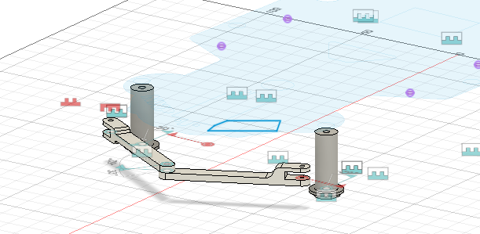
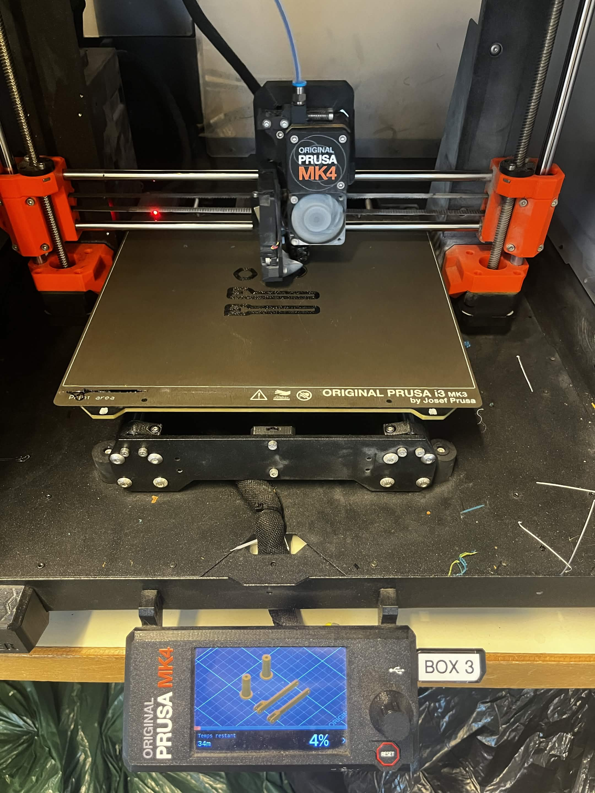
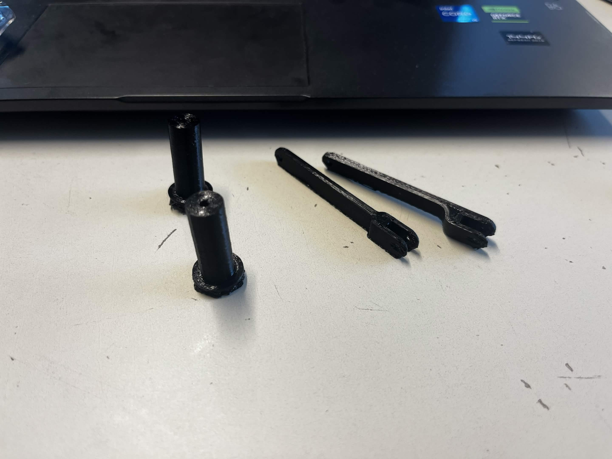

# Séance 01 – Pablo ONILLON--VALENCIA – 06/11/2026

## 🎯 Objectifs de la séance
- Lancer l'impression 3D du châssis (fichiers du kit NXP Cup)
- Installer l'environnement de développement Arduino
- Créer le dépôt GitHub du projet

## 🔧 Travail réalisé
### 1. Réflexion sur la fixation des cartes de calcul
J'ai échangé avec le professeur de CAO sur la conception du châssis. Comme le projet se déroule en deux phases avec deux cartes de calcul différentes, nous avons retenu la solution suivante : la plaque supérieure du châssis sera percée pour accueillir directement la carte de la phase 2. Pour la phase 1, un **support amovible** se vissera sur ces mêmes trous et portera l'Arduino Uno. Une fois la phase 1 terminée, il suffira de retirer ce support et de fixer la seconde carte à sa place, sans réimprimer la plaque.

### 2. Premier essai d'impression 3D
Avant de lancer les grandes pièces du châssis, j'ai imprimé **4 petites pièces** du système de direction du kit sur une imprimante 3D : **2 entretoises** et **2 bras de direction**. L'objectif était d'avoir un premier aperçu de la qualité d'impression et d'ajuster si nécessaire les paramètres des impressions suivantes.

| Paramètre | Valeur |
|---|---|
| Matériau | PETG noir |
| Durée d'impression | 39 min |
| Remplissage | 50 % |
| Options | Bordures et supports générés automatiquement |

  
  
  

<i>Pièces dans Fusion – Impression sur l'imprimante 3D – Pièces imprimées</i>

L'impression complète du châssis n'a donc pas encore été lancée ; elle se fera après validation des bon paramètres d'impression.

### 3. Environnement Arduino
L'IDE Arduino a été installé sur mon ordinateur. Aucun programme n'a encore été écrit ni téléversé.

### 4. Conception du support de carte sur Fusion
J'ai commencé la conception du support de l'Arduino Uno en relevant les cotes de la carte : dimensions, position et diamètre des 4 trous de fixation et hauteur des soudures sous la carte.

### 5. Dépôt GitHub
J'ai commencé à créer le dépôt GitHub du projet et son arborescence (rapports de séance, codes, CAO, documents, vidéos).

## ⚠️ Problèmes rencontrés et solutions
| Problème | Cause identifiée | Solution / piste |
|---|---|---|
| Bordures et supports difficiles à retirer des pièces imprimées | Bordures et supports activés sur des pièces petites et fines, donc très accrochés | Pour les prochaines impressions : désactiver la bordure sur les petites pièces et si besoin de support, utiliser les supports organiques |
| Trous de fixation du fichier Gitbook non adaptés à l'Arduino Uno | Le fichier est prévu pour une autre carte de calcul | Support amovible vissé sur les trous existants, avec ses propres trous adaptés à l'Arduino Uno |

## 🏠 Travail personnel (hors séance)
- Fin de la création du dépôt GitHub : arborescence, page d'accueil et premier rapport de séance

## ➡️ Objectifs de la prochaine séance
- Imprimer un maximum de pièces du châssis pendant la semaine, afin de commencer l'assemblage en séance
- Terminer la conception du support de l'Arduino Uno sur Fusion pour pouvoir l'imprimer
