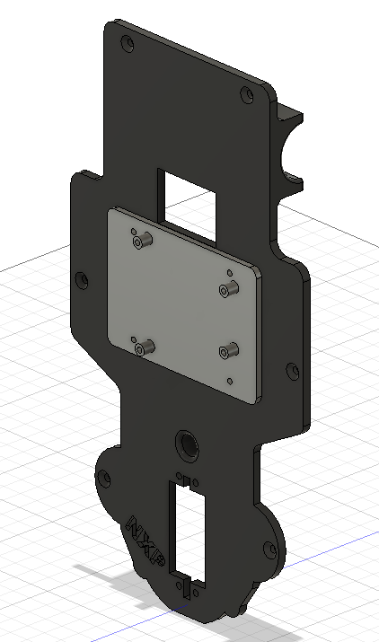
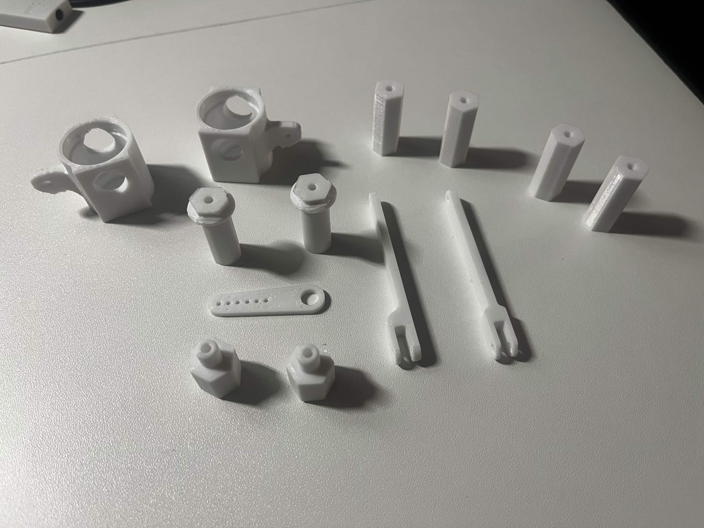

# Séance 02 – Pablo ONILLON--VALENCIA – 10/11/2026

## 🎯 Objectifs de la séance
- Imprimer un maximum de pièces du châssis afin de commencer l'assemblage
- Terminer la conception du support de l'Arduino Uno sur Fusion pour pouvoir l'imprimer

## 🔧 Travail réalisé
### 1. Nouvelle impression des pièces de direction
Lors de la séance 1, les supports générés automatiquement étaient trop difficiles à retirer des pièces. J'ai donc relancé en début de séance une impression avec les mêmes paramètres, mais avec des **supports organiques**. J'en ai profité pour imprimer d'autres pièces du kit :

| Pièce | Quantité |
|---|---|
| Fusées | 2 |
| Porte-fusées | 2 |
| Entretoises | 4 |
| Bras de direction | 2 |
| Moyeux hexagonaux | 2 |
| Palonnier de servomoteur | 1 |

| Paramètre | Valeur |
|---|---|
| Matériau | PETG |
| Durée d'impression | environ 2 h |
| Remplissage | 50 % |
| Options | Supports organiques |

J'ai récupéré l'impression en fin de séance : les supports organiques se retirent facilement et les pièces semblent utilisables. **Le problème rencontré lors de la séance 1 est donc résolu.**

### 2. Perçage de la plaque supérieure pour la DEBIX Model A
Comme décidé lors de la séance 1, j'ai ajouté sur Fusion les trous de fixation de la carte de la phase 2 dans la plaque supérieure du châssis. N'ayant pas encore la DEBIX Model A, j'ai relevé ses cotes dans sa documentation en ligne.

### 3. Conception du support de l'Arduino Uno
J'ai ensuite modélisé le support amovible de l'Arduino Uno. Il se fixe sur les trous prévus pour la DEBIX et porte 4 plots placés selon les trous de fixation de l'Arduino Uno, à partir des cotes relevées lors de la séance 1. Ces plots surélèvent la carte afin que les soudures situées sous celle-ci ne touchent pas le support.

### 4. Lancement de l'impression du châssis
Une fois le support terminé, j'ai lancé l'impression de la **plaque supérieure**, de la **plaque inférieure** du châssis et du **support de carte**. Cette impression dure environ **8 h 30** : elle sera récupérée et contrôlée lors de la prochaine séance.

  
  

<i>Plaque supérieure avec le support de l'Arduino Uno (en gris) – Pièces de direction imprimées</i>

## ⚠️ Problèmes rencontrés et solutions
| Problème | Cause identifiée | Solution / piste |
|---|---|---|
| Supports difficiles à retirer (séance 1) | Supports automatiques trop accrochés aux pièces | Résolu : utilisation de supports organiques |
| Cotes de la DEBIX Model A impossibles à mesurer | Carte de la phase 2 pas encore disponible | Cotes relevées dans la documentation en ligne, à vérifier sur la carte réelle à sa réception |
| Pièces non imprimées entre les séances | Seulement 3 jours entre les séances 1 et 2 | Impressions lancées en séance |

## ➡️ Objectifs de la prochaine séance
- Imprimer les pièces restantes
- Récupérer les plaques du châssis et le support, et vérifier que l'Arduino Uno s'y fixe correctement
- Commencer l'assemblage du châssis et du système de direction
- Si les composants sont disponibles, écrire un premier programme Arduino testé sur table, par exemple la commande du servomoteur de direction
