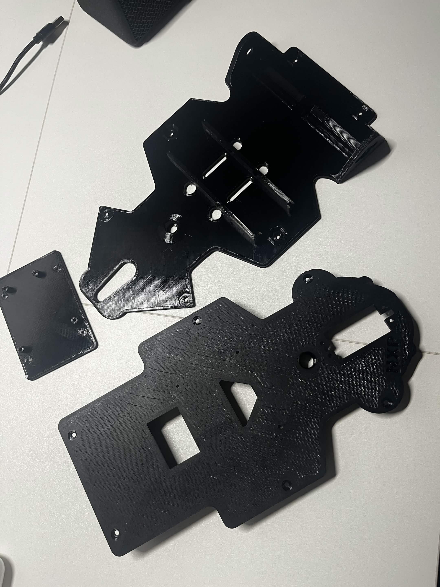
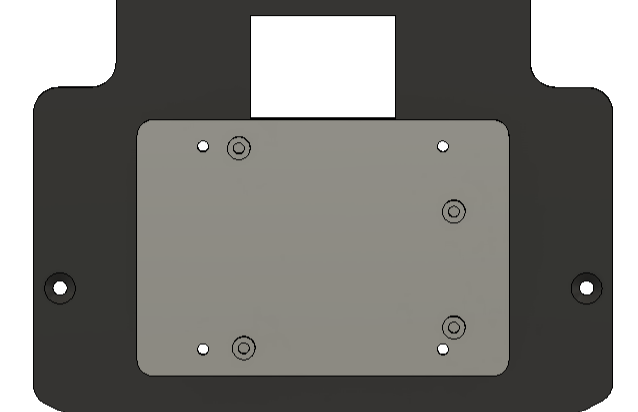
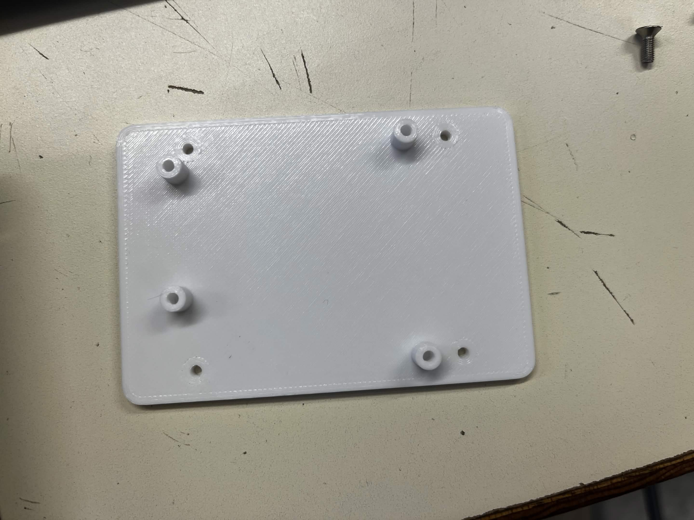
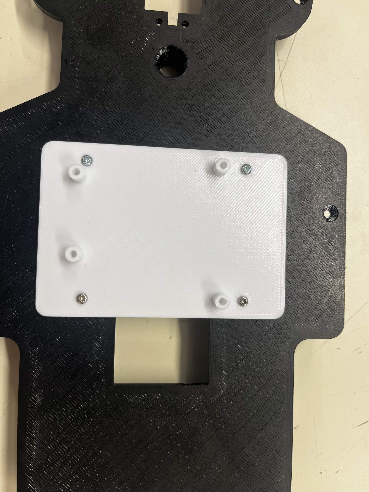
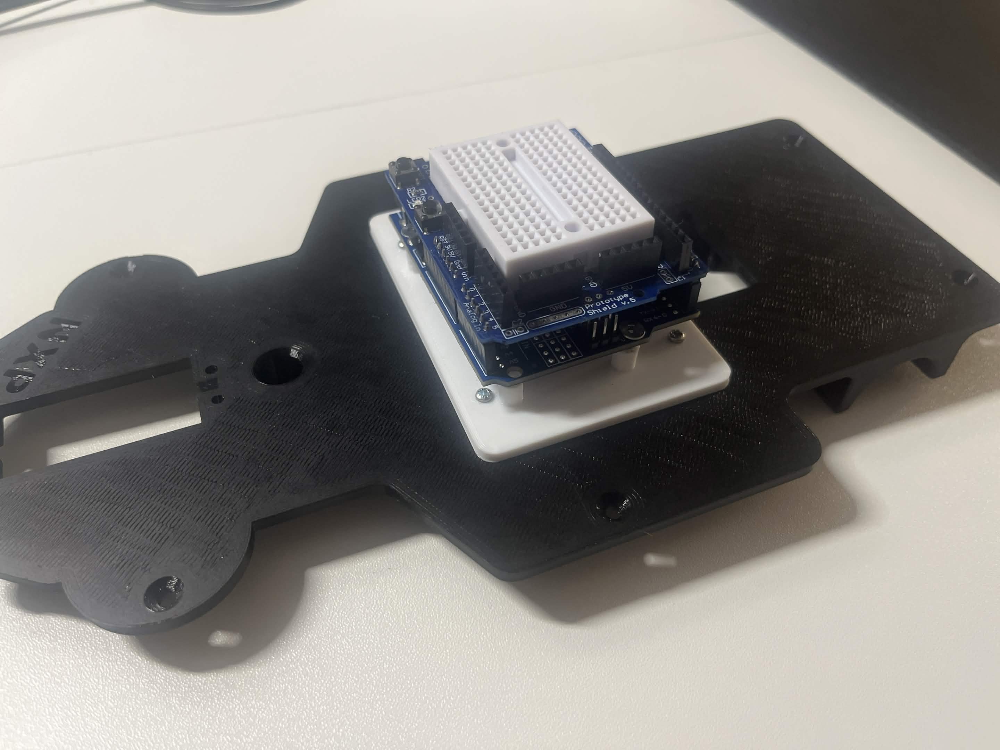

# Séance 03 – Pablo ONILLON--VALENCIA – 17/11/2026
 
## 🎯 Objectifs de la séance
 
- Imprimer les pièces restantes
- Récupérer les plaques du châssis et le support de carte, et vérifier que l'Arduino Uno s'y fixe correctement
- Commencer l'assemblage du châssis et du système de direction
- Si les composants sont disponibles, écrire un premier programme Arduino testé sur table (commande du servomoteur de direction)
### Bilan des objectifs
 
| Objectif | Résultat |
|---|---|
| Imprimer les pièces restantes | ✅ Support de carte réimprimé |
| Récupérer les pièces et fixer l'Arduino | ✅ Support fixé en séance, Arduino fixée hors séance |
| Commencer l'assemblage du châssis et de la direction | ⚠️ Commencé, mis en attente (fusées à réimprimer, moteurs non reçus) |
| Premier programme Arduino (servomoteur) | ❌ Composants pas encore reçus |
 
## 🔧 Travail réalisé
 
### 1. Récupération et contrôle des pièces imprimées
 
J'ai récupéré les plaques supérieure et inférieure du châssis ainsi que le premier support de carte. En le vérifiant, je me suis rendu compte que les trous de fixation de l'Arduino étaient disposés pour poser la carte « à l'envers », composants vers le bas. Or mon Arduino est équipée d'un shield : dans cette position, la carte ne peut pas être montée.
 

  

<i>Plaques supérieure et inférieure du châssis et premier support de carte imprimés en 3D</i>

 
### 2. Correction et réimpression du support de carte
 
Sur Fusion, j'ai appliqué une **symétrie axiale** aux trous de fixation de l'Arduino (entretoises) pour les placer du bon côté. Les 4 trous de fixation sur la plaque du châssis n'ont pas été modifiés. J'ai ensuite réimprimé le support corrigé.
 

  
  

<i>Modélisation du support corrigé sur la plaque supérieure – Nouveau support de carte</i>

 
### 3. Fixation du support sur la plaque supérieure
 
J'ai fixé le nouveau support sur la plaque supérieure du châssis avec **4 vis M2,5 × 10 et 4 écrous**.
 

  

<i>Support de carte fixé sur la plaque supérieure avec des vis M2,5 × 10 et des écrous</i>

 
### 4. Tentative de fixation de l'Arduino sur le support
 
Les entretoises du support ont des trous de **2,7 mm de diamètre**, dimensionnés pour des vis **M3** qui créent leur propre filetage dans le plastique (vissage autotaraudeur). La vis M3 ne rentrant pas facilement, j'ai pensé à tort qu'il ne fallait pas forcer, et j'ai essayé d'autres vis :
 
- des vis **M2** : beaucoup trop de jeu, la vis ne tient pas ;
- des vis **M2,5** : toujours du jeu, car la vis (2,5 mm) est plus petite que le trou (2,7 mm) et ne mord pas le plastique.
L'Arduino n'a donc pas pu être fixée pendant la séance (voir la solution dans le travail personnel).
 
### 5. Début de l'assemblage du châssis
 
En commençant l'assemblage, j'ai constaté que les **fusées** entraient trop difficilement dans le châssis. Je les ai réimprimées en utilisant le réglage **« Compensation de taille XY »** de PrusaSlicer, réglé à **-0,1 mm**, pour compenser la tolérance de l'imprimante.
 
Je n'ai pas poursuivi l'assemblage : les moteurs, qui se placent entre les deux plaques du châssis, ne sont pas encore arrivés. Assembler maintenant m'obligerait à tout démonter à leur arrivée.

 
## ⚠️ Problèmes rencontrés et solutions
 
| Problème | Cause identifiée | Solution / piste |
|---|---|---|
| L'Arduino ne peut pas être posée sur le premier support | Trous des entretoises positionnés pour une carte montée à l'envers, incompatible avec le shield | Symétrie axiale des trous sur Fusion , puis réimpression du support |
| La vis M3 ne rentre pas dans les entretoises | Trou de 2,7 mm volontairement plus petit que la vis : elle doit créer son propre filetage, il faut donc forcer | Visser la M3 en appuyant fermement (solution appliquée hors séance) |
| Les vis M2 et M2,5 ont du jeu | Diamètre de vis inférieur au diamètre du trou (2,7 mm) : la vis ne mord pas le plastique | Revenir aux vis M3 prévues lors de la conception |
| Les fusées rentrent mal dans le châssis | Tolérances de l'impression 3D (pièces légèrement plus grandes que le modèle) | Réimpression avec une compensation de taille XY de -0,1 mm dans PrusaSlicer |
| Assemblage du châssis mis en attente | Moteurs pas encore livrés | Assemblage reporté à leur réception |
 
## 🏠 Travail personnel (hors séance)
 
- **Compréhension du vissage autotaraudeur** : en échangeant avec mon père, j'ai compris qu'il est normal de forcer pour qu'une vis crée son propre filetage dans le plastique.
- **Choix de la longueur de vis** : les trous des entretoises sont borgnes (ils ne traversent pas la plaque du support). La vis dispose donc de 1,6 mm (épaisseur de l'Arduino) + 6 mm (entretoise) = **7,6 mm**. Une vis M3 × 10 est trop longue : elle bute au fond du trou avant de serrer la carte. J'ai donc choisi des vis **M3 × 8**.
- **Fixation de l'Arduino sur le support** : j'ai fixé la carte avec **2 vis M3 × 8** car la carte est parfaitement maintenue.

  

<i>Arduino Uno et son shield fixés sur le support avec 2 vis M3 × 8</i>

 
## ➡️ Objectifs de la prochaine séance
 
- Tester le montage des fusées réimprimées (ajustement dans le châssis et jeu des axes)
- Réaliser le schéma de câblage : Arduino, ponts en H, moteurs, servomoteur de direction et alimentation
- Écrire un premier programme Arduino testé sur table (commande d'un pont en H ou du servomoteur, selon le matériel disponible)
- Poursuivre l'assemblage du châssis dès la réception des moteurs
 
