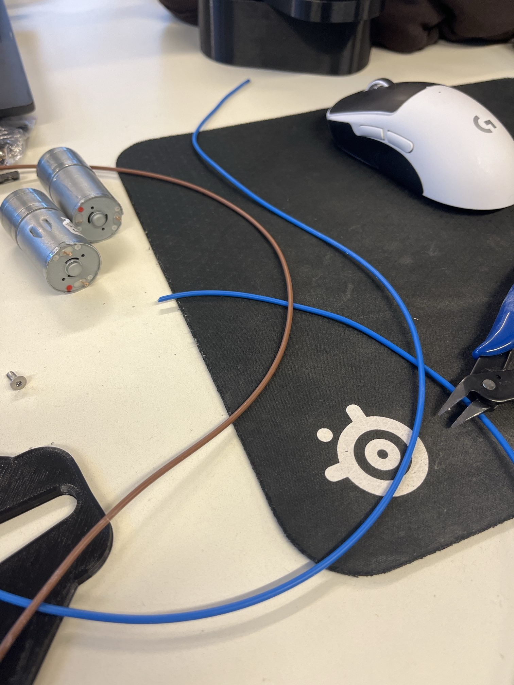
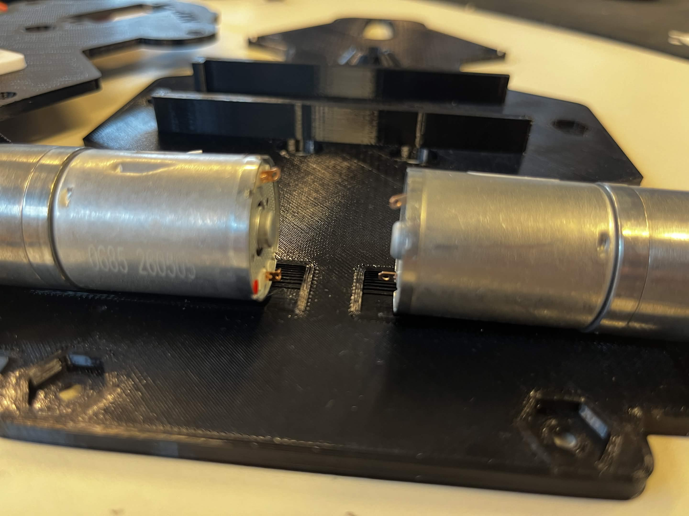
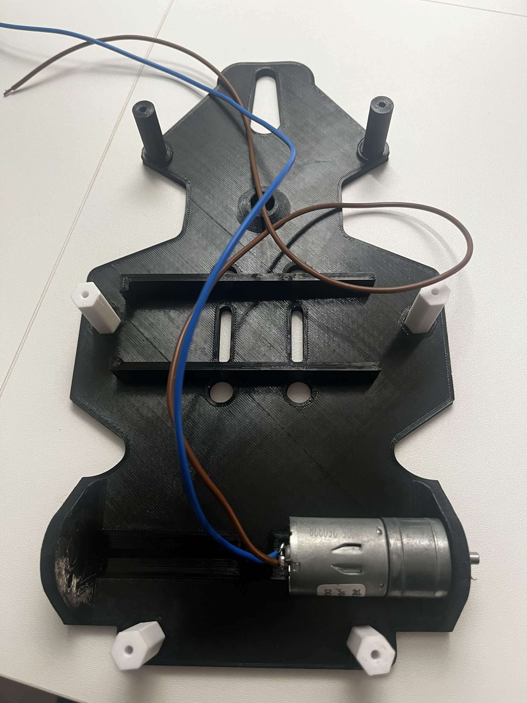

# Séance 04 – Pablo ONILLON--VALENCIA – 24/11/2026

## 🎯 Objectifs de la séance

- Tester le montage des fusées réimprimées (ajustement dans le châssis et jeu des axes)
- Réaliser le schéma de câblage : Arduino, ponts en H, moteurs, servomoteur de direction et alimentation
- Écrire un premier programme Arduino testé sur table
- Poursuivre l'assemblage du châssis dès la réception des moteurs

### Bilan des objectifs

| Objectif | Résultat |
|---|---|
| Tester le montage des fusées réimprimées | ✅ Les axes de fusée rentrent parfaitement dans le châssis |
| Réaliser le schéma de câblage | ❌ Reporté |
| Premier programme Arduino sur table | ❌ Reporté |
| Poursuivre l'assemblage dès la réception des moteurs | ✅ Moteurs reçus, assemblage commencé |

Ayant reçu mes moteurs en début de séance, j'ai décidé de donner la priorité à l'assemblage du châssis, qui était bloqué depuis la séance 3.

## 🔧 Travail réalisé

### 1. Préparation des fils d'alimentation des moteurs

J'ai d'abord fixé directement les moteurs sur la plaque inférieure du châssis. Mais leurs bornes étaient alors difficiles d'accès pour y souder les fils d'alimentation : je les ai donc retirés.

Pour les fils, j'ai récupéré les conducteurs d'un câble électrique : après avoir incisé et retiré la gaine, j'ai coupé des longueurs de fil bleu et marron, volontairement plus longues que nécessaire afin de pouvoir les recouper une fois le câblage définitif connu.

### 2. Soudure des fils sur les moteurs

J'ai réalisé ma **première soudure** : pour chaque fil, je l'ai dénudé, passé dans la borne du moteur, puis soudé à l'étain pour qu'il ne bouge plus.

J'ai choisi la convention suivante, identique sur les deux moteurs :
- fil bleu sur la borne **+** (repérée par un point rouge sur le moteur) ;
- fil marron sur la borne **−**.

  
  

<i>Fils d'alimentation récupérés – Bornes des moteurs (borne + repérée par un point rouge)</i>

### 3. Test et diagnostic des moteurs

Pour vérifier que les moteurs fonctionnent, je les ai alimentés avec un générateur de tension continue réglé à 6 V, leur tension nominale. Or, un seul des deux moteurs tourne et sur celui-ci, la vitesse de rotation varie bien avec la tension appliquée.

Avec mes professeurs, nous avons diagnostiqué le second moteur :
1. Mesure de la tension à ses bornes : elle est nulle.
2. Test sans le réducteur : il n'est pas possible faire tourner le tourner, même avec une pince.

Nous avons donc conclue que le rotor est bloqué mécaniquement. Ainsi le moteur est défectueux et devra être remplacé.

### 4. Début de l'assemblage du châssis

J'ai ensuite commencé l'assemblage de la plaque inférieure :
- fixation du moteur fonctionnel avec 2 vis M3 × 10 ;
- fixation des **4 entretoises** et des 2 axes de fusée avec 6 vis M3 × 16.

Les axes de fusée réimprimés lors de la séance 3 rentrent désormais parfaitement dans le châssis donc la compensation de taille XY de −0,1 mm appliquée dans PrusaSlicer est validée.

J'ai également récupéré le servomoteur MG996R qui commandera la direction.

  

<i>Plaque inférieure avec le moteur, les entretoises et les axes de fusée fixés</i>

## ⚠️ Problèmes rencontrés et solutions

| Problème | Cause identifiée | Solution / piste |
|---|---|---|
| Un des deux moteurs ne tourne pas | Rotor bloqué mécaniquement : moteur défectueux | Commander un nouveau moteur ; poursuivre l'assemblage avec le moteur fonctionnel |
| Bornes des moteurs difficiles d'accès une fois fixés | Moteurs montés avant le soudage des fils | Retrait des moteurs, soudure des fils, puis remontage |
| Inhalation de fumées de soudure | Fumées dégagées par le flux contenu dans le fil d'étain | Se retirer légèrement en gardant le visage hors du panache de fumée |
| Schéma de câblage et programme non réalisés | Priorité donnée à l'assemblage après la réception des moteurs | Reportés à la séance 5 |

## ➡️ Objectifs de la prochaine séance

- Poursuivre l'assemblage
- Réaliser le schéma de câblage (Arduino, pont en H, moteurs, servomoteur, batterie)
- Écrire un premier programme Arduino testé sur table : commande du servomoteur de direction
